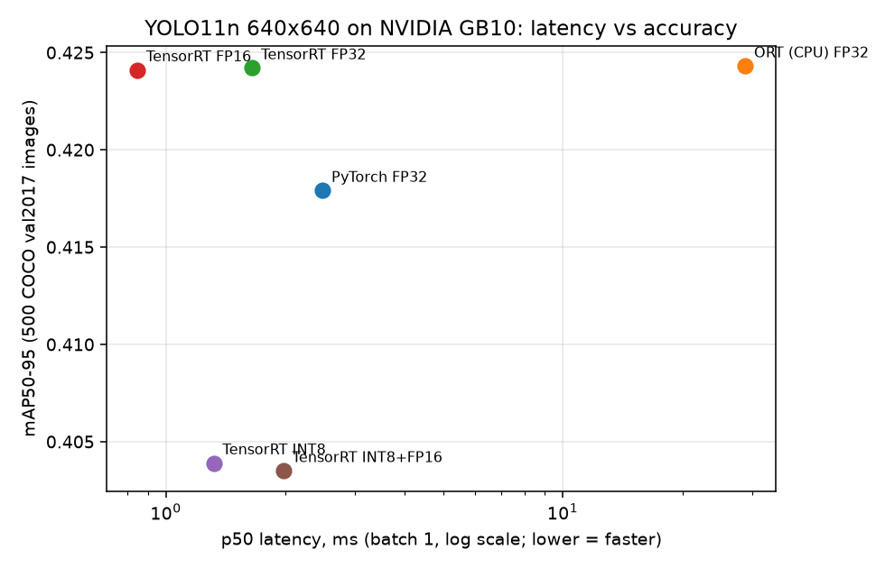
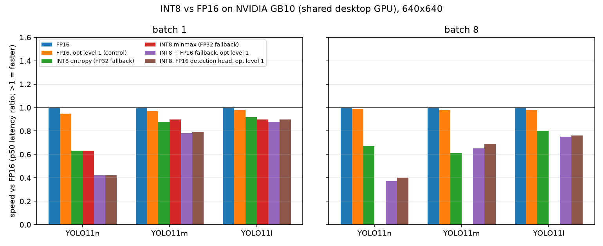

# yolo-tensorrt-edge

**[Try it in your browser](https://haiha-ux.github.io/yolo-tensorrt-edge/)**: YOLO11n via ONNX Runtime Web (WebGPU if the browser has it, otherwise WASM), upload an image or use the webcam. Browser numbers are not comparable to the TensorRT numbers below (different runtime, hardware and precision).

Take a YOLO model from PyTorch to ONNX to TensorRT (FP32, FP16, INT8), then measure latency, throughput and COCO accuracy with the same scripts for every backend, so the speed/accuracy trade-off is a number and not a claim. Everything here uses public assets only: Ultralytics YOLO11n official weights and a 500-image slice of COCO val2017.



## Results

YOLO11n, 640x640, batch 1, NVIDIA GB10 (Blackwell, aarch64 desktop-class GPU, CUDA 13, TensorRT 10.16, torch 2.11, ONNX Runtime 1.22). Raw data: `results/bench.json`, `results/eval.json`, `results/export_log.json`.

| Backend | Precision | mAP50-95 | mAP50 | p50 ms | p95 ms | FPS (batch 1) | File size MB |
|---|---|---|---|---|---|---|---|
| PyTorch eager | FP32 | 0.418 | 0.574 | 2.48 | 2.50 | 402 | 5.4 |
| ONNX Runtime (CPU) | FP32 | 0.424 | 0.577 | 28.82 | 43.28 | 32 | 10.2 |
| TensorRT | FP32 | 0.424 | 0.577 | 1.65 | 1.66 | 605 | 12.8 |
| TensorRT | FP16 | 0.424 | 0.577 | 0.85 | 0.86 | 1175 | 7.0 |
| TensorRT | INT8 (Ultralytics build) | 0.404 | 0.563 | 1.32 | 1.33 | 755 | 16.3 |
| TensorRT | INT8+FP16 (own builder, opt. level 1) | 0.404 | 0.562 | 1.98 | 1.99 | 505 | 52.5 |

FP16 is the clear choice on this GPU. It is about 2x faster than TensorRT FP32 and about 3x faster than PyTorch eager, with no measurable accuracy loss (0.424 against 0.424).

INT8 lost 2.0 mAP50-95 points and was slower than FP16 for this small model. YOLO11n is launch- and memory-bound rather than compute-bound, the quantize and dequantize nodes add work, and the INT8 engine file is larger than the FP16 one. The section below repeats the test with larger models, batch 8, 512 train2017 calibration images and an FP16 detection head, and INT8 stayed slower there too, so model size alone does not explain it. I did not try hardware with dedicated INT8 paths (Jetson Orin DLA) or quantization-aware training.

The INT8 rows in this first table used 200 val2017 images for calibration, kept apart from the evaluation images, with a MinMax calibrator. TensorRT recommends 300 or more; the larger study below uses 512 train2017 images.

Building INT8 with FP16 fallback through my own builder failed at TensorRT's default optimization level (`Myelin ... Could not find any implementation for node {ForeignNode[Quantize ...]}`). It only builds at `builder_optimization_level <= 1`, which is why that row is slower and larger. Read it as a reproducible failure report, not a tuned result.

ONNX Runtime ran on the CPU because the wheel on this machine has no CUDA provider, so its row is a CPU baseline. PyTorch's mAP is about 0.6 points lower than the ONNX and TensorRT runs because Ultralytics validates the `.pt` model with rectangular batches, while the exported models use fixed 640x640 letterboxing. The weights are the same.

## Browser demo

`docs/` is the GitHub Pages site: `index.html`, `app.js` (UI, letterbox, inference, drawing), `detect.js` (decoding and NMS), `yolo11n.onnx` (the same 10.2 MB FP32 640x640 export used above, no NMS inside) and a sample COCO val2017 image. ONNX Runtime Web 1.22.0 comes from jsDelivr (`ort.all.min.js`, pinned). The backend is WebGPU when `navigator.gpu` exists and the model loads on it, otherwise WASM (up to 4 threads); the page shows which one ran, and the per-frame inference time, pre-processing and NMS time.

- NMS is done in JavaScript, because the ONNX has the raw `[1, 84, 8400]` output: pick the best class per anchor, drop scores below the slider (default 0.25), greedy per-class NMS at IoU 0.45, keep 100 boxes.
- Check (`web_check/`): `nms_test.js` unit-tests IoU, NMS and decoding on synthetic data (Node). `gen_ref.py` runs Ultralytics on the same ONNX and sample image (conf 0.25, IoU 0.45); `run.mjs` loads the page in headless Chromium (Playwright, WASM backend, no GPU), runs the JS pipeline and matches boxes: 13 of 13 reference detections matched with the same class and IoU above 0.9, max score difference below 0.001.
- That headless run is a CPU/WASM sanity check: about 130 to 230 ms per frame on this shared machine, with other jobs running. I did not test WebGPU here (no GPU in the headless browser), so the WebGPU path is untested. Browser numbers say nothing about TensorRT latency: different runtime, hardware, FP32 only, and browser overhead.
- Local test: `cd docs && python3 -m http.server 8000`. The webcam needs HTTPS or localhost.

## When INT8 pays off

The first table only covers YOLO11n at batch 1, which is the case where INT8 has the least to gain. This section repeats the comparison for YOLO11n, YOLO11m and YOLO11l at batch 1 and batch 8, with a properly sized calibration set, and asks the plain question: on this GPU, does INT8 ever beat FP16?



| Model | Batch | Precision | mAP50-95 | p50 ms | p95 ms | img/s | Speed vs FP16 | Act. mem MB | Engine MB |
|---|---|---|---|---|---|---|---|---|---|
| YOLO11n | 1 | FP16 | 0.424 | 0.82 | 0.84 | 1203 | 1.00x | 16 | 7 |
| YOLO11n | 1 | INT8 entropy (FP32 fallback) | 0.300 | 1.31 | 3.03 | 655 | 0.63x | 26 | 18 |
| YOLO11n | 1 | INT8 minmax (FP32 fallback) | 0.406 | 1.31 | 1.32 | 759 | 0.63x | 26 | 19 |
| YOLO11n | 1 | INT8 + FP16 fallback, opt level 1 | 0.300 | 1.98 | 2.06 | 503 | 0.42x | 63 | 52 |
| YOLO11n | 1 | INT8, FP16 detection head, opt level 1 | 0.371 | 1.95 | 1.97 | 511 | 0.42x | 63 | 51 |
| YOLO11n | 8 | FP16 | 0.424 | 5.13 | 6.81 | 1425 | 1.00x | 125 | 6 |
| YOLO11n | 8 | INT8 entropy (FP32 fallback) | 0.300 | 7.71 | 7.82 | 1034 | 0.67x | 105 | 50 |
| YOLO11n | 8 | INT8 + FP16 fallback, opt level 1 | 0.300 | 13.76 | 14.62 | 576 | 0.37x | 505 | 388 |
| YOLO11n | 8 | INT8, FP16 detection head, opt level 1 | 0.371 | 12.87 | 13.71 | 612 | 0.40x | 505 | 370 |
| YOLO11m | 1 | FP16 | 0.555 | 2.64 | 2.97 | 374 | 1.00x | 55 | 41 |
| YOLO11m | 1 | INT8 entropy (FP32 fallback) | 0.490 | 2.99 | 3.24 | 331 | 0.88x | 45 | 27 |
| YOLO11m | 1 | INT8 minmax (FP32 fallback) | 0.537 | 2.94 | 2.98 | 338 | 0.90x | 45 | 27 |
| YOLO11m | 1 | INT8 + FP16 fallback, opt level 1 | 0.491 | 3.38 | 3.42 | 295 | 0.78x | 76 | 69 |
| YOLO11m | 1 | INT8, FP16 detection head, opt level 1 | 0.497 | 3.33 | 3.64 | 297 | 0.79x | 76 | 68 |
| YOLO11m | 8 | FP16 | 0.555 | 21.94 | 25.37 | 359 | 1.00x | 441 | 46 |
| YOLO11m | 8 | INT8 entropy (FP32 fallback) | 0.490 | 36.04 | 49.63 | 203 | 0.61x | 608 | 384 |
| YOLO11m | 8 | INT8 + FP16 fallback, opt level 1 | 0.491 | 33.51 | 37.12 | 235 | 0.65x | 608 | 401 |
| YOLO11m | 8 | INT8, FP16 detection head, opt level 1 | 0.497 | 31.84 | 37.01 | 244 | 0.69x | 608 | 386 |
| YOLO11l | 1 | FP16 | 0.569 | 3.41 | 3.82 | 287 | 1.00x | 64 | 51 |
| YOLO11l | 1 | INT8 entropy (FP32 fallback) | 0.510 | 3.71 | 4.37 | 264 | 0.92x | 49 | 32 |
| YOLO11l | 1 | INT8 minmax (FP32 fallback) | 0.553 | 3.78 | 3.82 | 263 | 0.90x | 49 | 32 |
| YOLO11l | 1 | INT8 + FP16 fallback, opt level 1 | 0.512 | 3.88 | 4.22 | 254 | 0.88x | 80 | 75 |
| YOLO11l | 1 | INT8, FP16 detection head, opt level 1 | 0.521 | 3.79 | 3.92 | 262 | 0.90x | 80 | 74 |
| YOLO11l | 8 | FP16 | 0.569 | 27.81 | 38.63 | 272 | 1.00x | 512 | 56 |
| YOLO11l | 8 | INT8 entropy (FP32 fallback) | 0.510 | 34.97 | 40.49 | 222 | 0.80x | 394 | 68 |
| YOLO11l | 8 | INT8 + FP16 fallback, opt level 1 | 0.512 | 37.31 | 41.27 | 210 | 0.75x | 644 | 406 |
| YOLO11l | 8 | INT8, FP16 detection head, opt level 1 | 0.521 | 36.58 | 49.76 | 205 | 0.76x | 644 | 391 |

Speed vs FP16 is the ratio of p50 latencies at the same model and batch (below 1.00x means slower than FP16). Act. mem is the execution-context activation memory TensorRT reports for the engine (`device_memory_size_v2`), not process-level GPU memory, because the GB10 shares memory with the CPU and `nvidia-smi` does not report it. Engine MB is the serialized engine size on disk. The INT8 minmax row exists at batch 1 only, as an accuracy check, and its speed matches the entropy INT8 build. The control rows (FP16 built at optimization level 1) and the `trtexec` GPU medians are in `results/int8_results.csv`.

Setup, exactly as run:
- Calibration: 512 images sampled with a fixed seed from COCO train2017 (`prepare_calib_train.py`, 81 MB), never val2017. Both TensorRT calibrators were tried, entropy (`IInt8EntropyCalibrator2`) and minmax. The calibration tables are kept in `results/calib/`, one per model and calibrator; the batch-8 engines reuse the table made on the batch-1 network.
- Accuracy: the same Ultralytics `val` call as above, 500 val2017 images, measured on the batch-1 engines. The batch-8 engines use the same weights and the same table, but their accuracy was not measured separately.
- Latency: the same harness as above (`bench.time_model`, 100 warm-up and 1000 timed runs, 3 passes, best p50), now with a batch dimension. img/s is the batch size divided by the mean latency.
- Static engines, one per model and batch size. FP16 and the plain INT8 builds use TensorRT's default optimization level. INT8 together with an FP16 fallback only built at optimization level 1 here (the same Myelin failure described above, reproduced for all three models), so those rows are compared against an FP16 control built at level 1 as well. The control is within about 5 percent of the default-level FP16 engine, so it does not change the picture.
- The "FP32 fallback" rows set only the INT8 flag, so layers without an INT8 kernel run in FP32. That is the configuration Ultralytics builds. The "FP16 fallback" and "FP16 detection head" rows set INT8 and FP16, and the head variant additionally pins the layers under `/model.23/` (the Detect block, 84 layers for YOLO11n) to FP16. The head variant is reported as its own row, not folded into INT8.

What the data says:
- On this GPU INT8 did not beat FP16 for any model, batch size or INT8 configuration I built. The best case was YOLO11l and YOLO11m at batch 1, where the INT8 builds reached 0.78x to 0.92x of FP16 speed (0.88x to 0.92x for the FP32-fallback builds). At batch 8 the INT8 builds were between 0.37x and 0.80x of FP16, and YOLO11l was the closest at 0.80x.
- The gap shrinks with model size at batch 1 (0.63x for n, 0.88x to 0.92x for m and l with the FP32-fallback builds), which fits the idea that the fixed overhead of the INT8 engine matters less as the convolutions get bigger. It did not keep shrinking at batch 8: YOLO11m at batch 8 was slower relative to FP16 (0.61x) than at batch 1. I did not profile layer by layer, so I cannot say which layers account for this.
- Calibrator choice dominates the accuracy cost. With minmax, INT8 lost 1.8 points of mAP50-95 on YOLO11n, 1.8 on YOLO11m and 1.6 on YOLO11l. With entropy it lost 12.5, 6.4 and 5.9 points. Keeping the detection head in FP16 recovered 7 points on YOLO11n but only 0.6 and 1.1 points on m and l, and still left entropy INT8 well behind minmax. I did not combine minmax with the FP16 head, so that combination is untested.
- Memory did not favour INT8 either. At batch 1 the INT8 builds with an FP32 fallback used somewhat less activation memory than FP16 for m and l (45 and 49 MB against 55 and 64 MB), but the INT8 engine files were smaller than FP16 for m and l (27 and 32 MB against 41 and 51 MB) but larger for n (18 against 7 MB). At batch 8 the INT8 engines were larger than FP16 for every model (50, 384 and 68 MB against 6, 46 and 56 MB), the builds with an FP16 fallback were larger than FP16 at every size, and activation memory was higher for m. I did not investigate why the batch-8 INT8 engine sizes vary so much between models.

Why INT8 loses here, stated as likely causes and not as measured facts. The GB10 is a Blackwell desktop-class GPU with strong FP16 tensor cores, so FP16 is already close to the compute the model needs, and INT8 has less headroom than on hardware where INT8 throughput is a large multiple of FP16. YOLO11 is mostly convolution plus SiLU and concat, and an implicit-quantization INT8 engine inserts reformat and dequantize steps wherever it mixes INT8 with FP16 or FP32 layers, and those steps cost time on a model that is partly memory-bound. A different route might behave differently, for example explicit Q/DQ quantization (quantization-aware training or a Q/DQ ONNX) instead of the implicit calibrator used here, or a Jetson Orin where INT8 and DLA paths exist. I did not test either, so the conclusion is limited to this GPU, this TensorRT version and the implicit calibration flow.

Practical reading for a client: "INT8 does not work" is too strong, but "INT8 is a free speed-up" is wrong too. On this class of GPU, use FP16 and keep the accuracy. Evaluate INT8 only on the target device, with a minmax or otherwise validated calibration set from the deployment scene, and measure latency and mAP before adopting it. These are numbers from a shared desktop GPU (aarch64, GB10), not a Jetson, other users' jobs were running on the machine, so treat the figures as relative.

## How the numbers were measured

- Accuracy (`eval.py`): Ultralytics `val`, conf 0.001, NMS IoU 0.7, on the first 500 images (sorted by filename, with labels) of COCO val2017. 500 images is a subset: mAP is comparable across rows here, not to published full-val numbers.
- Latency (`bench.py`): model forward pass only, random FP32 input already on the GPU, no letterbox/NMS, `cuda.synchronize` around each call. 100 warm-up + 1000 timed runs, 3 passes, best-p50 pass reported (the GPU is a shared machine; per-pass p50s are in `bench.json`). FPS = 1000 / mean latency, i.e. sequential batch-1 throughput. The batch 1 table above is the only one with PyTorch and ONNX Runtime rows; batched throughput for TensorRT is in the INT8 section.
- `bench.json` also holds `trtexec` GPU-compute medians for the engines (kernel time only, a bit different from the end-to-end numbers above).
- Not Jetson: this is a GB10 desktop GPU. Jetson numbers will differ, in absolute value and likely in the FP16/INT8 ratio.

## Reproduce

```bash
pip install -r requirements.txt            # CUDA-enabled torch + TensorRT 10.x required
mkdir -p weights && curl -L -o weights/yolo11n.pt https://github.com/ultralytics/assets/releases/download/v8.3.0/yolo11n.pt
python prepare_data.py     # downloads COCO val2017 (~800 MB) + labels, builds 500 eval / 200 calib subsets
python export.py           # ONNX + TensorRT FP32/FP16/INT8/INT8+FP16 into engines/ (~2 min)
python bench.py            # -> results/bench.json   (~4 min)
python eval.py             # -> results/eval.json    (~1 min)
python plot.py             # -> results/results.md, results/latency_vs_map.png
pytest -q tests            # each backend loads and detects on one image

# INT8 study (YOLO11n/m/l, batch 1 and 8): needs weights/yolo11m.pt and weights/yolo11l.pt from the same release URL
python prepare_calib_train.py   # 512 train2017 images for calibration (81 MB)
python int8_study.py build      # static engines + calibration tables in results/calib/ (roughly 45 min)
python int8_study.py bench      # -> results/int8_bench.json (roughly 30 min)
python int8_study.py eval       # -> results/int8_eval.json
python int8_study.py report     # -> results/int8_results.csv/.md, results/int8_vs_fp16.png
```

Whole pipeline after the data download took about 6.5 minutes on this machine. Weights, engines and data are git-ignored.

## What I would do on a Jetson Orin / Qualcomm NPU (approach, not measured here)

- Jetson Orin: export ONNX on the host, build the TensorRT engine on the device (engines are not portable across GPU architectures/TRT versions), lock clocks with `nvpmodel`/`jetson_clocks` before benchmarking, and measure with `trtexec` plus an end-to-end pipeline (camera decode, letterbox, NMS) because pre/post-processing often dominates on small models. Try FP16 first, then INT8 with 500+ representative calibration frames from the real deployment scene, and check whether layers can run on the DLA with GPU fallback. Verify mAP on the customer's own labelled data, not only COCO.
- Qualcomm NPU (e.g. Hexagon via QNN / AI Hub): export a static-shape ONNX, quantize to INT8/W8A8 with a calibration set from the target domain, compile with the Qualcomm toolchain, and compare on-device accuracy and latency to the FP32 reference layer by layer when accuracy drops. Detection heads (box decode, NMS) are typically kept off the NPU or simplified.
- In both cases the same workflow as this repo applies: one script per stage, an identical eval harness across precisions, and raw numbers saved next to the code.

## License

MIT. Author: Ha Phan Thanh Hai.
